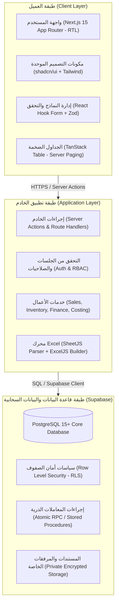
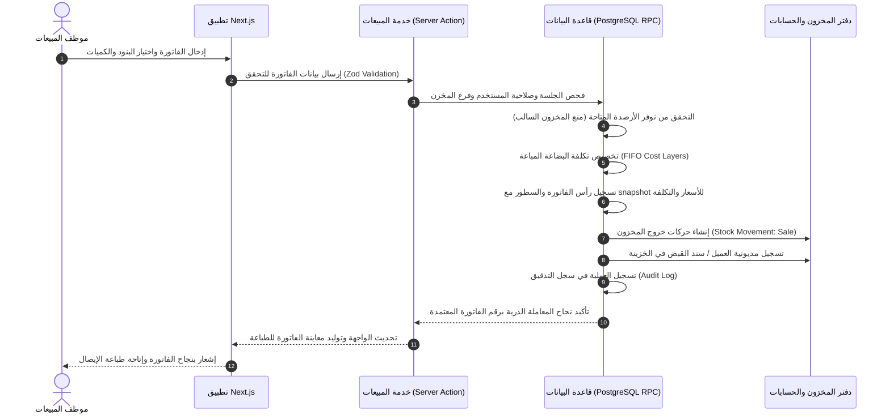
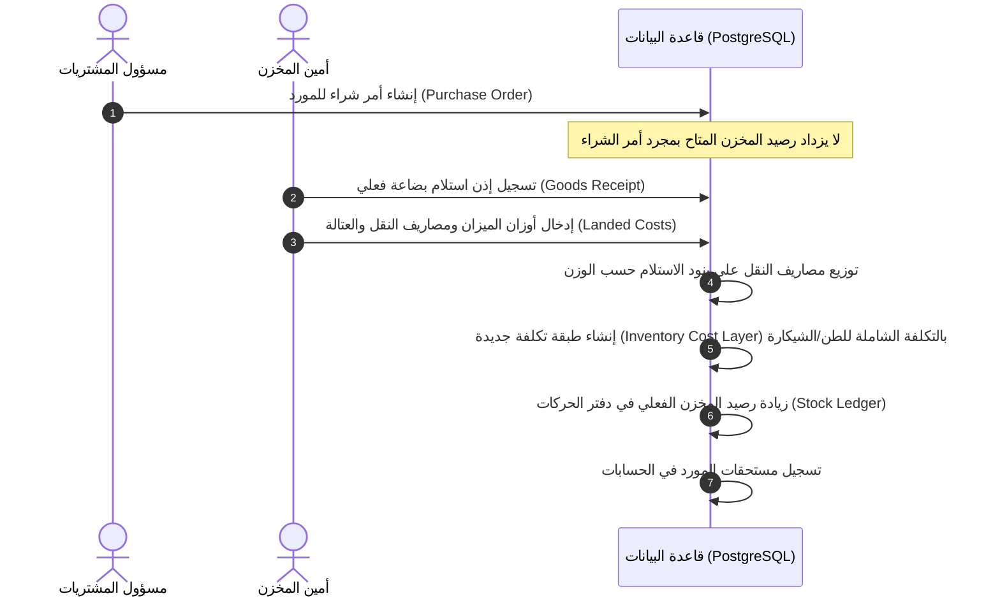

# المعمارية والتصميم الهندسي للنظام (System Architecture)
## نظام إدارة مخازن وتجارة مواد البناء (ERP)

---

## 1. المبادئ الهندسية الحاكمة (Architectural Invariants)

صُممت المعمارية لضمان سلامة العمليات التجارية والمحاسبية لسنوات طويلة، مع الالتزام التام بالقواعد التالية:

1. **قاعدة البيانات هي المصدر الوحيد للحقيقة (Single Source of Truth):**
   * المتصفح والواجهة مجرد طبقة عرض وإدخال؛ لا يُعتمد أبداً على الحسابات المرسلة من المتصفح (المجاميع، الخصومات، التكلفة، أو الأرصدة). يتم إعادة حساب كل شيء والتحقق منه على الخادم وقاعدة البيانات.
2. **ثبات البيانات والتكاليف التاريخية (Historical Immutability):**
   * أي فاتورة مبيعات، أمر شراء، أو حركة مخزون معتمدة تصبح غير قابلة للتعديل.
   * تغير سعر الأسمنت أو الحديد في السوق اليوم لا يجوز بأي حال أن يعيد تقييم فاتورة قديمة أو يحول ربحاً تاريخياً محققاً إلى خسارة.
   * يتم تسجيل سعر البيع، والكمية، وتكلفة الوحدة المخصصة (`historical_unit_cost`) في سطر الفاتورة كـ Snapshot لحظة الاعتماد.
3. **المعاملات الذرية (Atomic DB Transactions):**
   * العمليات المالية والمخزنية متعددة الخطوات (مثل اعتماد فاتورة يخصم مخزوناً، ويثبت مديونية عميل، ويسجل دفعة في الخزينة) تُنفذ داخل PostgreSQL Transaction / Stored Procedure واحدة. إذا فشلت أي خطوة، يتم التراجع الكامل (Rollback) لمنع أي تباين في الأرصدة.
4. **سجل الحركات المتراكم (Append-Only Ledgers):**
   * لا يوجد حذف نهائي (`DELETE`) لأي مستند أو حركة معتمدة.
   * التصحيح يتم دائماً بمستند عكسي مرتبط بالأصل (Reversal Document / Credit Note)، أو تسوية جردية معتمدة مع تسجيل كامل في سجل التدقيق (`audit_logs`).
5. **عزل الصلاحيات متعدد المستويات (Multi-Layer Security):**
   * تطبيق الصلاحيات على مستوى واجهة المستخدم (لتحسين التجربة)، وعلى مستوى الخادم (Server Actions)، وعلى مستوى قاعدة البيانات عبر سياسات أمان الصفوف (Row Level Security - RLS).

---

## 2. بنية الطبقات التقنية (Layered Architecture)

---

## 3. تدفق العمليات الحيوية (Core Business Workflows)

### 3.1 دورة حياة فاتورة المبيعات واعتمادها (Sales Invoice Lifecycle)

### 3.2 دورة حياة أمر الشراء وتخصيص التكلفة (Purchase & Receiving)

---

## 4. تصميم النواة المالية والمخزنية (Core Engine Architecture)

### 4.1 دفتر المخزون المتراكم (Immutable Stock Ledger)
* لا يوجد في النظام عمود يسمى "الرصيد" يُعدل يدوياً بالزيادة أو النقصان.
* رصيد أي منتج في أي مخزن هو ناتج الاستعلام التراكمي عن جدول حركات المخزون (`stock_movements`):
  $$\text{Current Stock} = \sum (\text{Inbound Movements}) - \sum (\text{Outbound Movements})$$
* **أنواع الحركات المخزنية المعتمدة:**
  * `OPENING_BALANCE`: رصيد افتتاحي موثق.
  * `PURCHASE_RECEIPT`: استلام مشتريات مورد.
  * `SALES_ISSUE`: خروج بضاعة مبيعات.
  * `SALES_RETURN`: مرتجع مبيعات صالح.
  * `SUPPLIER_RETURN`: مرتجع لمورد.
  * `TRANSFER_OUT` / `TRANSFER_IN`: تحويل صادر ووارد بين المخازن.
  * `ADJUSTMENT_ADD` / `ADJUSTMENT_SUB`: تسوية جردية رسمية معتمدة.
  * `SCRAP_ISSUE`: هالك وتالف موثق.

### 4.2 محرك تخصيص التكاليف (Cost Allocation Engine)
* لكل حركة استلام مشتريات، يتم إنشاء سجل في جدول طبقات التكلفة (`inventory_cost_layers`) يتضمن:
  * الكمية الأصلية المستلمة.
  * الكمية المتبقية المتاحة للاستهلاك (`remaining_quantity`).
  * تكلفة الشراء الصافية للوحدة.
  * نصيب الوحدة من مصاريف الشراء الإضافية (النولون والتفريغ).
  * إجمالي التكلفة الشاملة للوحدة (`total_landed_unit_cost`).
* عند اعتماد فاتورة بيع بالـ FIFO:
  1. يستهلك المحرك أقدم الطبقات المفتوحة للمنتج في المخزن المحدد.
  2. يسجل في جدول `cost_allocations` ربطاً صريحاً بين سطر الفاتورة والطبقة المستهلكة والكمية والتكلفة المحسوبة.
  3. يوثق إجمالي تكلفة البضاعة المباعة (COGS) في سطر الفاتورة نهائياً.

---

## 5. ضوابط الأمان والصلاحيات والنسخ الاحتياطي (Security & Disaster Recovery)

### 5.1 ضوابط الأمان (Security Controls)
* **RLS Policies:** كل جدول يحوي `tenant_id` / `organization_id` مع تفعيل RLS لمنع تسرب البيانات بين الفروع أو الشركات.
* **إدارة الأسرار:** المفتاح العام `NEXT_PUBLIC_SUPABASE_ANON_KEY` لا يملك صلاحية تجاوز RLS. مفتاح `SERVICE_ROLE` محصور داخل بيئة الخادم المشفرة للمهام المجدولة ذات الصلاحيات المرتفعة.
* **حماية Excel:** تعقيم جميع المخرجات لمنع ثغرات حقن الصيغ (CSV/Formula Injection) عن طريق بادئة علامات التنصيص الفردية لأي نص يبدأ برموز `+`, `-`, `=`, `@`.

### 5.2 النسخ الاحتياطي والتعافي من الكوارث (Backup & Recovery)
* **استقلالية النسخ:** حفظ لقطات يومية مجدولة من قاعدة البيانات (`pg_dump` مشفر) في مخزن سحابي منفصل كلياً عن مزود الاستضافة الأساسي.
* **نسخ الملفات الثنائية (Storage):** مزامنة دورية لملفات الـ PDFs والصور المرفوعة في Supabase Storage مع مزود تخزين أرشيفي ثانوي (S3 / Cloudflare R2).
* **اختبار الاستعادة (Restore Drills):** التزام دوري باختبار استعادة لقطة النسخ الاحتياطي على بيئة نظيفة والتأكد من فتح النظام ومطابقة أرصدته بنسبة 100%.
