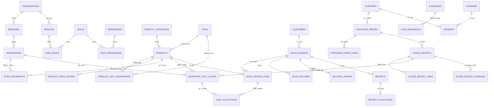

# مخطط العلاقات وقاعدة البيانات (Entity Relationship Diagram - ERD)
## نظام إدارة مخازن وتجارة مواد البناء (ERP)

---

## 1. الرسم البياني للعلاقات الرئيسية (Mermaid ERD)

---

## 2. النواة الأساسية: الكيانات والعلاقات التفصيلية

### 2.1 المنشأة والمستخدمون والصلاحيات (Core Access & Org)
1. **`organizations` (المنشأة/الشركة):**
   * الكيان الرئيسي لعزل البيانات (Multi-tenancy support).
   * الحقول الأساسية: `id`, `name_ar`, `tax_number`, `commercial_registration`, `phone`, `currency` (EGP), `timezone` (Africa/Cairo), `created_at`.
2. **`branches` (الفروع):**
   * الفروع الجغرافية أو التجارية التابعة للمنشأة.
   * الحقول: `id`, `organization_id`, `name_ar`, `code`, `address`, `phone`, `is_active`.
3. **`warehouses` (المخازن والمستودعات):**
   * مواقع تخزين الأسمنت، الحديد، الساحات المفتوحة للرمل والزلط.
   * الحقول: `id`, `organization_id`, `branch_id`, `name_ar`, `code`, `is_scrap_yard` (لمخزن التوالف)، `address`.
4. **`profiles` (المستخدمون):**
   * الحسابات الفردية لكل مدير وموظف مرتبطة بـ `auth.users` في Supabase.
   * الحقول: `id` (FK to auth.users), `organization_id`, `branch_id`, `full_name`, `phone`, `max_discount_percent`, `is_active`.
5. **`roles` & `permissions` & `role_permissions` & `user_roles`:**
   * إدارة الصلاحيات الدقيقة (RBAC) مع دعم تخصيص الصلاحيات لكل دور ولكل مستخدم.

---

### 2.2 دليل المنتجات ووحدات القياس وتتبع الأسعار (Catalog & Units)
1. **`units` (وحدات القياس):**
   * مثل: طن، كيلو، شيكارة، متر مكعب، سيارة/نقلة، ألف طوبة، قطعة.
   * الحقول: `id`, `code` (TON, BAG, M3, KG), `name_ar`, `decimal_precision` (مثلاً 3 أرقام عشرية للطن، و0 للشيكارة والقطعة).
2. **`product_categories` (التصنيفات):**
   * أسمنت، حديد، رمل وزلط، طوب، جبس، عوازل ومواد كيميائية.
3. **`products` (الأصناف والمنتجات):**
   * الحقول الأساسية: `id`, `organization_id`, `category_id`, `code` (فريد), `name_ar`, `base_unit_id`, `min_reorder_level`, `is_active`.
   * **خصائص مواد البناء المتخصصة:**
     * `steel_diameter_mm` (قطر الحديد بالمليمتر: 8، 10، 12، 16...).
     * `steel_nominal_weight_per_meter` (الوزن الهندسي النظري للمتر الطولي).
     * `bag_weight_kg` (وزن الشيكارة: 50 كجم للأسمنت، 25 أو 40 كجم للجبس).
     * `bulk_type` (سائب بالمتر المكعب كالرمل والزلط / وحدات معبأة).
4. **`product_unit_conversions` (معاملات التحويل المتخصصة):**
   * لكل منتج معامل تحويل فريد (مثال: طن أسمنت السويدي = 20 شيكارة).
   * الحقول: `id`, `product_id`, `from_unit_id`, `to_unit_id`, `multiplier` (NUMERIC 18,6), `version`, `effective_date`.
5. **`product_price_history` (سجل تغير الأسعار الحالية):**
   * الحقول: `id`, `product_id`, `old_price`, `new_price`, `price_type` (سعر بيع تجاري، سعر جملة، سعر استبدال مرجعي)، `reason`, `changed_by`, `effective_at`.

---

### 2.3 دفتر المخزون وتكلفة البضاعة المباعة (Stock Ledger & Costing)
1. **`stock_movements` (دفتر حركات المخزون - Append-Only Ledger):**
   * المصدر الوحيد لحساب الرصيد. غير قابل للتعديل أو الحذف.
   * الحقول: `id`, `organization_id`, `warehouse_id`, `product_id`, `movement_type` (PURCHASE_RECEIPT, SALE_ISSUE, TRANSFER_IN, TRANSFER_OUT, ADJUSTMENT_ADD, ADJUSTMENT_SUB, RETURN_IN), `quantity_base_unit` (موجب للوارد، سالب للمنصرف), `unit_cost_allocated`, `source_document_type`, `source_document_id`, `movement_at`, `created_by`.
2. **`inventory_cost_layers` (طبقات تكلفة المخزون - FIFO Engine):**
   * تسجل كل دفعة شراء لخصم تكلفة المنصرف منها بالترتيب.
   * الحقول: `id`, `organization_id`, `warehouse_id`, `product_id`, `goods_receipt_line_id`, `initial_quantity`, `remaining_quantity`, `purchase_unit_price`, `landed_cost_per_unit`, `total_unit_cost`, `is_fully_exhausted`, `received_at`.
3. **`cost_allocations` (تخصيص التكلفة لسطور المبيعات):**
   * يربط كل سطر فاتورة بيع بالطبقات التي استنزفت منها تكلفته.
   * الحقول: `id`, `sales_invoice_line_id`, `cost_layer_id`, `quantity_drawn`, `unit_cost`, `total_cost`.

---

### 2.4 المبيعات والفواتير (Sales & Invoicing)
1. **`customers` (العملاء والمقاولون):**
   * الحقول: `id`, `organization_id`, `code`, `name_ar`, `phone`, `tax_id`, `commercial_reg`, `credit_limit`, `payment_terms_days`, `opening_balance`, `current_balance`, `is_active`.
2. **`sales_invoices` (رؤوس الفواتير):**
   * الحقول: `id`, `organization_id`, `branch_id`, `warehouse_id`, `invoice_number` (Unique, e.g. INV-2026-0001), `customer_id`, `invoice_date`, `status` (DRAFT, PENDING_APPROVAL, APPROVED, COMPLETED, CANCELLED, REVERSED), `payment_type` (CASH, CREDIT, MULTI), `subtotal`, `discount_amount`, `tax_amount`, `freight_charge`, `total_amount`, `paid_amount`, `remaining_balance`, `approved_by`, `approved_at`, `created_by`.
3. **`sales_invoice_lines` (سطور الفواتير - Historical Snapshot):**
   * الحقول: `id`, `sales_invoice_id`, `product_id`, `product_name_snapshot`, `quantity_entered`, `unit_entered_id`, `conversion_factor`, `quantity_base_unit`, `unit_price_snapshot`, `discount_amount`, `tax_amount`, `total_line_amount`, `historical_cogs_allocated` (التكلفة التاريخية للبند وقت البيع), `historical_gross_profit`.

---

### 2.5 المشتريات والتوريد ومصاريف الشراء (Procurement & Landed Costs)
1. **`suppliers` (الموردون والمصانع):**
   * مصانع الأسمنت، تجار الحديد، أصحاب المحاجر والمقالع.
   * الحقول: `id`, `organization_id`, `code`, `name_ar`, `supplier_type` (CEMENT_FACTORY, STEEL_MILL, QUARRY), `phone`, `current_balance`.
2. **`purchase_orders` & `purchase_order_lines` (أوامر الشراء):**
   * الحقول: الاتفاق المسبق على الكميات والأسعار المبدئية قبل التوريد الفعلي.
3. **`goods_receipts` & `goods_receipt_lines` (أذون استلام البضاعة الفعلية):**
   * نقطة دخول المخزون الفعلي بعد فحص الشاحنات والوزن البسكول.
   * الحقول: `id`, `purchase_order_id`, `warehouse_id`, `supplier_document_number`, `gross_weight_kg`, `tare_weight_kg`, `net_weight_kg`, `status` (RECEIVED, VERIFIED).
4. **`goods_receipt_expenses` (مصاريف النولون والعتالة المصاحبة للشراء):**
   * الحقول: `id`, `goods_receipt_id`, `expense_type` (FREIGHT_NOLON, UNLOADING_MASHAL, WEIGHING_FEE), `amount`, `paid_to_party`, `allocation_method` (BY_WEIGHT, BY_VALUE).

---

### 2.6 الخزائن والمعاملات النقدية (Cash & Finance)
1. **`cashboxes` (الخزائن والبنوك):**
   * الخزينة الرئيسية، عهدة البيع، الحسابات البنكية.
   * الحقول: `id`, `organization_id`, `branch_id`, `name_ar`, `type` (CASH, BANK), `current_balance`, `is_active`.
2. **`cash_movements` (دفتر حركات الخزائن - Append-Only):**
   * الحقول: `id`, `cashbox_id`, `movement_type` (RECEIPT, PAYMENT, TRANSFER_IN, TRANSFER_OUT, ADJUSTMENT), `amount`, `source_document_type`, `source_document_id`, `notes`, `created_by`, `created_at`.
3. **`receipts` & `receipt_allocations` (سندات القبض وتحصيل العملاء):**
   * الحقول: إثبات استلام النقدية أو التحويل وربطه بفاتورة العميل لتخفيض مديونيته.
4. **`payments` & `payment_allocations` (سندات الصرف وسداد الموردين):**
   * الحقول: إثبات صرف مستحقات الموردين أو المصروفات التشغيلية.
5. **`cash_sessions` (الورديات وإغلاق الخزينة اليومي):**
   * الحقول: `id`, `cashbox_id`, `opened_by`, `opened_at`, `opening_cash`, `closed_by`, `closed_at`, `expected_cash`, `actual_cash_counted`, `variance_amount`, `notes`.

---

### 2.7 التوصيل والخدمات اللوجستية (Logistics & Delivery)
1. **`vehicles` & `drivers` (الأسطول والسائقون):**
   * الحقول: أرقام اللوحات، الحمولة القصوى بالأطنان، اسم السائق، الهاتف، الرخصة.
2. **`delivery_orders` & `delivery_order_lines` (أوامر التوصيل والتسليم بالموقع):**
   * الحقول: `id`, `sales_invoice_id`, `vehicle_id`, `driver_id`, `destination_address`, `status` (PREPARING, DISPATCHED, DELIVERED, RETURNED_PARTIAL), `delivery_date`, `proof_of_delivery_url`.

---

### 2.8 الأمان والتدقيق ومركز Excel (Audit, System & Excel)
1. **`audit_logs` (سجل النشاط والتدقيق الأمني):**
   * الحقول: `id`, `organization_id`, `user_id`, `action` (INSERT, UPDATE, APPROVE, REVERSE, LOGIN, EXPORT), `entity_name`, `entity_id`, `old_values` (JSONB), `new_values` (JSONB), `ip_address`, `created_at`.
2. **`import_jobs` & `import_job_rows` (محرك استيراد Excel الموثوق):**
   * الحقول: `id`, `file_name`, `target_entity` (PRODUCTS, CUSTOMERS, OPENING_STOCK), `total_rows`, `valid_rows`, `invalid_rows`, `status` (PREVIEWING, COMMITTED, FAILED), `mapping_config` (JSONB), `created_by`.
3. **`document_sequences` (توليد أرقام المستندات المتتالية الذرية):**
   * الحقول: `id`, `organization_id`, `document_type` (INV, PO, REC, PAY, TRN), `prefix`, `current_value`, `fiscal_year`.
